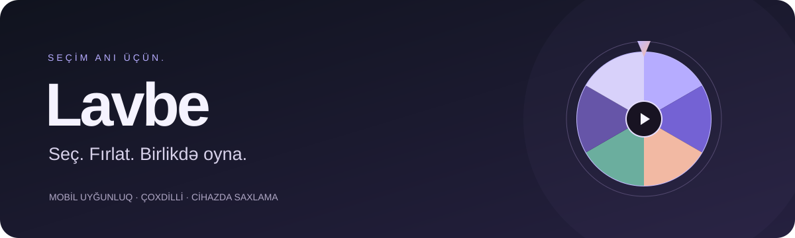
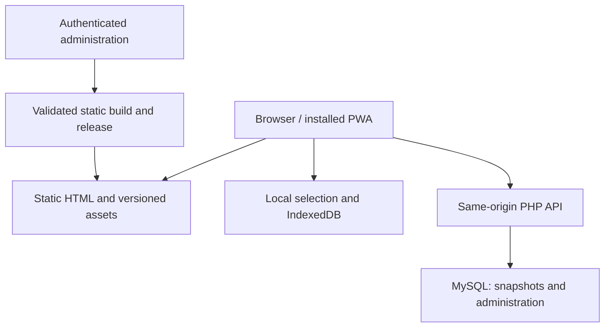

<div align="center">



# Lavbe Wheel

**Spin. Decide. Play together.**

A fast, multilingual wheel and social-game platform designed for phones, tablets and desktops.

**[Azərbaycan dilində](README.md) · [Start here](docs/00-START-HERE.md) · [Product specification](docs/01-PRODUCT.md) · [Codex execution](docs/15-IMPLEMENTATION.md) · [Release gates](docs/16-ACCEPTANCE.md)**


</div>

> **Repository status:** documentation and executable contract examples only. The application, translations, game library, administration panel and integrations are **not implemented**. Badges describe the specification; they are not passing test, security, accessibility or legal certifications. Target domain: **lavbe.com**; this repository does not establish a live deployment.

## 🎯 Product promise

Open an immediately usable wheel, paste names, spin and understand the result. Switch to a bottle or social game without relearning the interface. Keep your session, inspect results and share a working wheel.

Lavbe is designed for complete-scope delivery. Internal implementation increments are allowed; an incomplete public MVP is not. Routine maintenance remains necessary after release.

## ✨ The experience

| | Capability | Required behavior |
|---|---|---|
| 🎡 | Selection tools | Names, integer ranges, yes/no, visible weights and balanced team allocation |
| 🍾 | Bottle and social play | Explicit seating, rounds, non-repeating cards and safe skip/pause controls |
| 💞 | Couples and groups | Non-explicit, culturally reviewed game packs; no pressured or dangerous tasks |
| ⚡ | Motion and speed | Local selection, precise landing, adaptive effects and measurable frame budgets |
| 🌗 | Themes | System/light/dark, no initial flash, persisted choice and tool-specific styling |
| 📱 | Responsive UX | Touch-first controls, tablet orientation layouts and keyboard accessibility |
| 🌍 | Localization | 110 planned locale records; reviewed translations and RTL layouts before launch |
| 📊 | Reports | Durable local history, counts, observed share, round boundaries and CSV export |
| 🔗 | Sharing | Immutable snapshots, unguessable URLs, expiry and a separate revocation secret |
| 💾 | Local-first storage | Autosave, recovery, versioned imports and explicit exports without an account |
| 📲 | PWA | Installable experience and cached-tool offline use with non-disruptive updates |
| 🛡️ | Privacy | Minimal data, consent-controlled integrations and no names in analytics |

### Planned differentiation

Wheel of Names already provides rich customization, sharing, weighted entries and many languages. Lavbe's intended advantage is a coherent mobile flow, purpose-built social games and durable session reporting. Faster performance and better usability must be demonstrated by comparative tests, not asserted from this specification. See [competitive review and red-team findings](docs/18-RED-TEAM.md).

## 🧭 Documentation map

| Icon | Document | What Codex must learn |
|---|---|---|
| 🧭 | [Start here](docs/00-START-HERE.md) | Reading order, authority and status |
| 🎯 | [Product](docs/01-PRODUCT.md) | Locked scope, modes and limits |
| 🎨 | [UX and design](docs/02-UX-DESIGN.md) | Screens, responsive behavior, themes and icon usage |
| ⚡ | [Motion and performance](docs/03-MOTION-PERFORMANCE.md) | Timing, text fitting and measurement |
| 🎲 | [Selection and games](docs/04-SELECTION-GAMES.md) | Algorithms, state transitions and game rules |
| 📊 | [Sessions and reports](docs/05-SESSIONS-REPORTS.md) | Exactly-once records, rounds and exports |
| 🔗 | [Sharing](docs/06-SHARING.md) | Snapshot lifecycle, capabilities and privacy |
| 🌍 | [Localization](docs/07-I18N.md) | 110 locales, negotiation and review gates |
| 🔎 | [Search](docs/08-SEO.md) | Crawlable routes, indexing and content quality |
| 📲 | [PWA](docs/09-PWA.md) | Offline matrix, cache boundaries and updates |
| 💰 | [Ads and measurement](docs/10-MONETIZATION.md) | Placement rules, GTM, GA4 and consent |
| 🛡️ | [Privacy and security](docs/11-PRIVACY-SECURITY.md) | Threat model, data map and operator obligations |
| 🏗️ | [Architecture](docs/12-ARCHITECTURE.md) | Monorepo, static build and PHP API |
| 🗃️ | [Data and contracts](docs/13-DATA-CONTRACTS.md) | Storage, database, API and migrations |
| 🛠️ | [Admin and publishing](docs/14-ADMIN-CONTENT.md) | Packs, translations, publishing and rollback |
| 🤖 | [Implementation plan](docs/15-IMPLEMENTATION.md) | Ordered work packages and required evidence |
| ✅ | [Acceptance](docs/16-ACCEPTANCE.md) | Traceable release gates and negative tests |
| 🚀 | [Operations](docs/17-OPERATIONS.md) | Shared hosting, deployment, backup and recovery |
| 🧨 | [Red-team](docs/18-RED-TEAM.md) | Failure scenarios and residual risks |
| 📝 | [Decisions and launch inputs](docs/19-DECISIONS.md) | Resolved defaults and external blockers |
| 📚 | [Sources](docs/20-SOURCES.md) | Primary references and review dates |
| 🧩 | [Icon catalog](docs/assets/ICONS.md) | Complete repository documentation icon set |

## 🏗️ Architecture at a glance



**Build:** Astro + TypeScript. **Interaction:** Canvas plus semantic HTML controls. **Persistence:** IndexedDB. **Server:** PHP + PDO/MySQL. **Delivery:** Apache-compatible shared hosting with optional CDN. Node is needed for build tooling, not a persistent production server. Dependency versions must be selected from supported releases during bootstrap and pinned in lockfiles.

## 🤖 Start with Codex

Read [AGENTS.md](AGENTS.md), then [the start guide](docs/00-START-HERE.md) and [the implementation plan](docs/15-IMPLEMENTATION.md). Implement every mandatory requirement and record evidence against [the acceptance matrix](docs/16-ACCEPTANCE.md).

Suggested instruction:

> Implement Lavbe from this repository's normative specifications. Start by validating the documentation package and creating the prescribed monorepo. Follow AGENTS.md and the ordered work packages. Preserve local-first privacy and all release gates. Do not publish incomplete scope, fabricate translations or credentials, or claim checks that were not run. Record remaining external launch inputs without blocking independent implementation.

### What runs today

Python 3.11+ is sufficient for the dependency-free documentation checks:

```bash
python3 scripts/validate_docs.py
```

The check validates relative links, unique locale codes, SVG XML, required contract fields and representative fixtures. It does **not** validate a deployed application. A separate strict JSON Schema check can be run when `jsonschema` is installed:

```bash
python3 scripts/validate_contracts.py
```

Application installation/build/test commands are specified as a **future required command contract** in [the implementation plan](docs/15-IMPLEMENTATION.md); they do not exist yet. Do not mistake a proposed directory tree for implemented source.

## 🔬 Readiness review

The [readiness audit](docs/21-READINESS-AUDIT.md) records historical findings and their current closure. Full session/admin schemas, semantic vectors and the screen contract now define implementation behavior. Runtime equivalence, real-device visual acceptance and external launch inputs remain implementation/release gates.

## ✅ Definition of complete

All tools and games work end to end; all 110 launch locales pass review; storage and sharing survive failures; reports remain correct; motion and accessibility are verified on real devices; ads do not obstruct use; consent is verified at the network level; deployment and restore are rehearsed. External account approval, search ranking and legal compliance are not guaranteed by a green CI run.

No feature count, Lighthouse score or decorative badge substitutes for the [release evidence](docs/16-ACCEPTANCE.md).

## 🔒 Scope boundaries

No explicit sexual content, public user-content marketplace, chat, live multi-device multiplayer, accounts for ordinary use or certified lottery claims. No fake freshness, automatic translation presented as reviewed, simulated revenue or tracking before the required consent.

## 🤝 Working on this repository

- Read [CONTRIBUTING.md](CONTRIBUTING.md) for changes and review evidence.
- Read [SECURITY.md](SECURITY.md) before reporting a vulnerability; do not disclose secrets in public issues.
- See [CHANGELOG.md](CHANGELOG.md) for specification changes.
- No open-source license has been selected by the owner. Public visibility does not constitute a license grant. Record dependency and asset licenses during implementation.

---

<div align="center">

**Lavbe · Built around the moment of choice.**

Specification baseline: **2026-11-14** · Application status: **not implemented**

</div>
