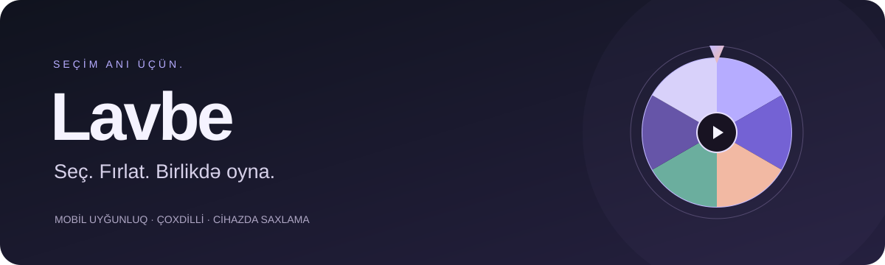
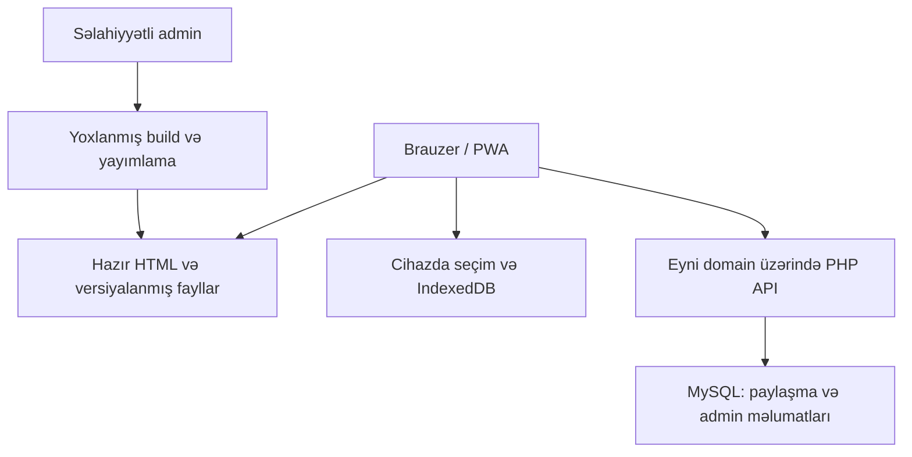

<div align="center">



# 🎡 Lavbe Wheel

**Seç. Fırlat. Birlikdə oyna.**

Mobil, planşet və kompüter üçün sürətli, çoxdilli seçim alətləri və sosial oyun platforması.

**[English](README.en.md) · [Başlanğıc](docs/00-START-HERE.md) · [Məhsul tələbləri](docs/01-PRODUCT.md) · [Codex icra planı](docs/15-IMPLEMENTATION.md) · [Qəbul meyarları](docs/16-ACCEPTANCE.md)**


</div>

> **Reponun hazırkı vəziyyəti:** WP01, WP02 və WP07 üçün əsas avtomatlaşdırılmış yoxlamalar CI-dən keçib. WP03-də local sessiya yaddaşı, nəticə bərpası və tablararası writer lease; WP04–WP06-da əsas çarx, hesabatlar, butulka və sosial oyun axınları tətbiq olunub, amma vizual qəbulu və bəzi alət davranışları açıqdır. WP08-də MFA admin paneli, məzmun baxışı və imzalı publish runner tətbiq olunub. WP09 üçün draft PR #9 açıqdır; indeksləmə qapısı və SEO artefaktları ilə yanaşı, lokallaşdırılmış 8 ictimai route/template yerli build-də işləyir. WP10 üçün PWA manifesti, ikonları, offline cache və istifadəçi razılığına bağlı yeniləmə axını `feat/wp10-pwa` üzərində hazırlanır; fiziki cihaz qəbulu açıqdır. 110 locale research qeydi pending, `en` və `az` UI kataloqları draft, oyun kartları isə yalnız ingiliscə draftdır. Qalan lokal marşrutlar, hüquqi səhifələr, consent inteqrasiyaları və buraxılış yoxlamaları açıqdır. Hədəf domain **lavbe.com**-dur; sayt yayımlanmayıb.

## 🎯 Lavbe nə edəcək?

Saytı aç, adları daxil et, çarxı fırlat və nəticəni gör. Butulka və ya sosial oyun rejiminə keç, hazır tapşırıqlarla birlikdə oyna. Siyahını itirmədən sessiyanı davam etdir, nəticələri cədvəldə izlə və işlək çarxı linklə paylaş.

**MVP olmayacaq.** Razılaşdırılmış bütün məcburi imkanlar tamamlanıb yoxlanmadan ictimai buraxılış edilməyəcək. İşin daxildə mərhələlərə bölünməsi yarımçıq məhsulun yayımlanması demək deyil. Buraxılışdan sonra təhlükəsizlik və xarici xidmətlərlə uyğunluq üçün texniki qulluq davam edəcək.

## ✨ Əsas imkanlar

| İkon | İmkan | Tələb olunan davranış |
|---|---|---|
| 🎡 | Seçim alətləri | Ad çarxı, tam ədəd seçimi, bəli/xeyr, açıq göstərilən çəkilər və balanslı komanda bölgüsü |
| 🍾 | Butulka | İştirakçıların yerləri istifadəçi tərəfindən müəyyən edilir; nəticə istiqamətlə dəqiq uyğunlaşır |
| 💞 | Birlikdə oyun | Cütlük, dost qrupu, tanışlıq və doğruluq/cəsarət paketləri; keçmək, fasilə və təkrarsız kartlar |
| ⚡ | Sürət və animasiya | Seçim cihazda hesablanır; axıcı fırlanma, dəqiq dayanma və cihaz gücünə uyğun effektlər |
| 🌗 | Gecə/gündüz | Sistemə uyğun, açıq və tünd mövzular; yadda saxlanan seçim və ilk açılışda rəng sıçramasının qarşısı |
| 📱 | Rahat interfeys | Toxunma, klaviatura, planşetin istiqaməti və müxtəlif ekran ölçülərinə uyğun idarəetmə |
| 🔤 | Adların yerləşməsi | Faktiki mətn eninə görə şrift ölçüsü; minimum oxunaqlılıq həddi və tam adı ayrıca görmək |
| 🌍 | 110 dil | Tam lokallaşdırma, sağdan sola yazı və dilə uyğun məzmun; buraxılışdan əvvəl hər dilin yoxlanması |
| 📊 | Hesabat | Tarixçə, seçilmə sayı, nəticələrdə pay, raundlar və CSV ixracı |
| 🔗 | Paylaşma | Adlar və ayarlarla sabit nüsxə; bitmə müddəti və ayrıca ləğv açarı |
| 💾 | Saxlama | Qeydiyyatsız avtomatik cihaz yaddaşı, bərpa, geri alma və fayla ixrac/idxal |
| 📲 | PWA | Ana ekrana əlavə etmə, əvvəl yüklənmiş alətlərin offline istifadəsi və oyunu kəsməyən yenilənmə |
| 🛡️ | Məxfilik | Minimum məlumat, razılıqla işləyən inteqrasiyalar və analitikaya göndərilməyən adlar |

### Bizi nə fərqləndirməlidir?

Wheel of Names artıq fərdiləşdirmə, paylaşma, çəkili seçim və çoxdillilik təqdim edir. Lavbe-nin nəzərdə tutulan fərqi **rahat mobil istifadə, hər rejimə uyğun vizual xarakter, bütöv sosial oyun məntiqi və davamlı sessiya hesabatıdır**. Daha sürətli və rahat olduğumuz yalnız real müqayisəli testlə sübut edilə bilər. [Rəqib müqayisəsi və red-team təhlili](docs/18-RED-TEAM.md).

## 🧭 Sənədlərin xəritəsi

Normativ texniki sənədlər icra dəqiqliyi üçün ingiliscədir. Layihənin əsas təqdimatı bu Azərbaycan dilində README-dir.

| İkon | Sənəd | Codex üçün məqsəd |
|---|---|---|
| 🧭 | [Başlanğıc](docs/00-START-HERE.md) | Oxuma sırası, sənədlərin statusu və üstünlük qaydası |
| 🎯 | [Məhsul](docs/01-PRODUCT.md) | Funksional əhatə, rejimlər və limitlər |
| 🎨 | [UX və dizayn](docs/02-UX-DESIGN.md) | Ekranlar, adaptiv düzülüş, mövzular və ikonlar |
| ⚡ | [Animasiya və sürət](docs/03-MOTION-PERFORMANCE.md) | Hərəkət, mətnin yerləşməsi və performans ölçmələri |
| 🎲 | [Seçim və oyunlar](docs/04-SELECTION-GAMES.md) | Alqoritmlər, vəziyyətlər və oyun qaydaları |
| 📊 | [Sessiyalar və hesabat](docs/05-SESSIONS-REPORTS.md) | Nəticələrin təkrarsız qeydi, raundlar və ixrac |
| 🔗 | [Paylaşma](docs/06-SHARING.md) | Linkin ömrü, səlahiyyət açarları və məxfilik |
| 🌍 | [Lokallaşdırma](docs/07-I18N.md) | 110 dil, avtomatik seçim və tərcümə yoxlamaları |
| 🔎 | [SEO](docs/08-SEO.md) | İndekslənən səhifələr, dil əlaqələri və məzmun keyfiyyəti |
| 📲 | [PWA](docs/09-PWA.md) | Offline imkanlar, keş sərhədləri və yenilənmə |
| 💰 | [Reklam və ölçmə](docs/10-MONETIZATION.md) | Yerləşimlər, GTM, GA4 və razılıq |
| 🛡️ | [Məxfilik və təhlükəsizlik](docs/11-PRIVACY-SECURITY.md) | Risklər, məlumat xəritəsi və operator öhdəlikləri |
| 🏗️ | [Arxitektura](docs/12-ARCHITECTURE.md) | Monorepo, statik build və PHP API |
| 🗃️ | [Məlumat və müqavilələr](docs/13-DATA-CONTRACTS.md) | Saxlama, verilənlər bazası, API və miqrasiyalar |
| 🛠️ | [Admin və məzmun](docs/14-ADMIN-CONTENT.md) | Paketlər, tərcümələr, yayımlama və geri dönüş |
| 🤖 | [Codex icra planı](docs/15-IMPLEMENTATION.md) | Asılılıqlara görə iş paketləri və tələb olunan sübutlar |
| ✅ | [Qəbul meyarları](docs/16-ACCEPTANCE.md) | Buraxılış yoxlamaları və xəta ssenariləri |
| 🚀 | [Yerləşdirmə və istismar](docs/17-OPERATIONS.md) | Shared hosting, ehtiyat nüsxə, bərpa və monitorinq |
| 🧨 | [Red-team](docs/18-RED-TEAM.md) | Uğursuzluq ssenariləri və qalan risklər |
| 📝 | [Qərarlar və xarici məlumatlar](docs/19-DECISIONS.md) | Sabitlənmiş seçimlər və buraxılış üçün real girişlər |
| 📚 | [İstinadlar](docs/20-SOURCES.md) | Əsas mənbələr və yoxlama tarixi |
| 🔬 | [İcraya hazırlıq auditi](docs/21-READINESS-AUDIT.md) | Hazırlıq qiymətləndirməsi, düzəlişlər və qalan boşluqlar |
| 🧩 | [İkon kataloqu](docs/assets/ICONS.md) | 36 yerli SVG ikon və istifadə qaydaları |

## 🏗️ Texniki quruluş



| Qat | Seçilmiş texnologiya |
|---|---|
| Səhifələr və build | Astro + TypeScript |
| Animasiya | Canvas; idarəetmə üçün semantik HTML |
| Cihaz yaddaşı | IndexedDB |
| Server | PHP + PDO/MySQL |
| Yerləşdirmə | Apache uyğun shared hosting; statik fayllar üçün istəyə bağlı CDN |

Node build zamanı lazımdır; istehsal serverində daimi Node prosesi tələb edilmir. Asılılıqların dəstəklənən versiyaları ilkin texniki qurulumda seçilib lockfile-larla sabitlənməlidir.

## 🤖 Codex haradan başlamalıdır?

Əvvəl [AGENTS.md](AGENTS.md), sonra [başlanğıc sənədi](docs/00-START-HERE.md) və [icra planı](docs/15-IMPLEMENTATION.md) oxunmalıdır. İşin nəticəsi [qəbul matrisi](docs/16-ACCEPTANCE.md) üzrə sübutlarla qeyd edilməlidir.

Codex-ə verilə biləcək tapşırıq:

> Bu repodakı normativ sənədlər əsasında Lavbe-nin tam funksional əhatəsini icra et. Əvvəl sənəd yoxlamalarını işə sal, tamamlanmış sessiya/admin sxemlərini və semantik vektorları əsas götürərək monoreponu qur. AGENTS.md və iş paketlərinin sırasına əməl et. Məlumatı qoruyan lokal saxlamanı və bütün buraxılış meyarlarını saxla. Yarımçıq məhsulu yayımlama, tərcümə rəyləri və hesab məlumatları uydurma. İcra edilmiş yoxlamaları, qalan xarici girişləri və məhdudiyyətləri aydın göstər.

### Hazırda işləyən yoxlamalar

Lokal işlək klassik çarxı işə salmaq:

```bash
npm ci
npm run dev
```

Veb səhifə `http://127.0.0.1:4321/` ünvanında açılır. PHP foundation üçün `composer install --working-dir=apps/api`; tələb olunan PHP versiyası 8.3+ və `intl`, `mbstring`, `pdo_mysql`, `sodium` genişlənmələridir.

Tətbiq və müqavilə yoxlamaları:

```bash
npm run check
npm run test:unit
npm run test:e2e
npm run test:a11y
npm run test:seo
npm run test:content
npm audit --audit-level=moderate
```

`test:api` hazırda PHP runtime ilkin şərtlərini yoxlayır; HTTP paylaşma/admin API-si WP07–08-də qurulacaq. `test:pwa` PWA işi WP10-da tamamlanana qədər açıq şəkildə bloklanır. Bunlar həmin imkanların keçdiyini göstərmir.

Python 3.11+ ilə sənəd və müqavilə yoxlamaları:

```bash
python3 scripts/validate_docs.py
```

Sxem və nümunələrin ciddi yoxlanması:

```bash
python3 -m pip install -r scripts/requirements-docs.txt
python3 scripts/validate_contracts.py
python3 scripts/validate_semantics.py
python3 scripts/validate_seo_contract.py
```

Bu yoxlamalar keçidlər, dil siyahısı, SVG, müqavilə uyğunluğu və nümunələri yoxlayır. **Bunlar tətbiqin bütün funksiyalarını, real PHP HTTP serverini, cihaz qəbulunu və ya hüquqi uyğunluğu təsdiqləmir.** Tam qəbul statusu [icra planında](docs/15-IMPLEMENTATION.md) və [progress.json](docs/progress.json) faylında sübutlarla izlənir.

## ✅ Nə vaxt hazır sayılacaq?

Bütün alətlər və oyunlar başdan sona işlədikdə; 110 dilin rəyləri tamamlandıqda; saxlama, paylaşma və hesabat xəta ssenarilərində düzgün qaldıqda; real cihazlarda sürət və əlçatanlıq yoxlandıqda; reklam/razılıq davranışı şəbəkə səviyyəsində təsdiqləndikdə; yerləşdirmə və bərpa sınaqları keçdikdə.

Xarici reklam təsdiqi, axtarış sıralaması və hüquqi qiymətləndirmə CI-nin uğurlu nəticəsi ilə zəmanət verilən nəticələr deyil. [Qəbul meyarları](docs/16-ACCEPTANCE.md) və [xarici girişlər](docs/19-DECISIONS.md) birlikdə yoxlanmalıdır.

## 🔒 Əhatə sərhədləri

Açıq seksual məzmun, çat, açıq istifadəçi şablonları bazarı, ayrı cihazlardan sinxron canlı oyun, adi istifadə üçün hesab məcburiyyəti və sertifikatlaşdırılmış lotereya iddiası yoxdur. Saxta yenilənmə tarixləri, yoxlanmış kimi göstərilən tərcümələr və tələb olunan razılıqdan əvvəl izləmə olmayacaq.

## 🤝 Repo ilə iş

- [CONTRIBUTING.md](CONTRIBUTING.md) — dəyişiklik və yoxlama qaydaları.
- [SECURITY.md](SECURITY.md) — təhlükəsizlik bildirişləri; açıq issue-lara məxfi məlumat yazılmır.
- [CHANGELOG.md](CHANGELOG.md) — sənəd dəyişiklikləri.
- Açıq mənbə lisenziyası sahibi tərəfindən hələ seçilməyib. Reponun açıq görünməsi lisenziya icazəsi deyil. Tətbiq mərhələsində asılılıqların və aktivlərin lisenziyaları qeydə alınmalıdır.

---

<div align="center">

**Lavbe · Seçim anı üçün düşünülmüş təcrübə.**

Sənəd bazası: **14 noyabr 2026** · Tətbiq: **WP01–WP02 verified · WP03 implemented, CI passed, review pending · WP04 in progress · WP05–WP12 open**

</div>

## Əlavə icra müqavilələri

- [Semantik yoxlama və bərpa](docs/22-SEMANTIC-CONTRACT.md)
- [Ekranların vizual müqaviləsi](docs/23-SCREEN-CONTRACT.md)

- [Hüquqi səhifələr və production qəbulu](docs/24-LEGAL-LAUNCH.md)

## 🔎 SEO — əsas icra istiqaməti

[Texniki SEO müqaviləsi](docs/25-SEO-EXECUTION.md) · [SEO qəbul matrisi](docs/26-SEO-ACCEPTANCE.md)

Sorğu–səhifə xəritəsi, indeks siyasətləri, URL ssenariləri və 110 dil üçün araşdırma növbəsi config/seo daxilindədir. Real bazar araşdırması və hazır sayt testləri ayrıca icra ediləcək; sənədlərdə trafik və sıralama zəmanəti verilmir.

## 🎨 Vizual keyfiyyət və UI/UX

[Art-direksiya](docs/27-ART-DIRECTION.md) · [Komponentlər və animasiya](docs/28-COMPONENT-MOTION.md) · [Dizayn qəbulu](docs/29-DESIGN-ACCEPTANCE.md)

Lavbe-nin istiqaməti: **sakit interfeys, ifadəli çarx**. Yüksək dizayn keyfiyyəti hədəfdir; real ekranlar, hərəkət, cihaz testləri və vizual qəbul tamamlanmadan əldə edilmiş nəticə sayılmır.

## 🤖 Agent və GitHub iş qaydaları

[AGENTS.md](AGENTS.md) · [Branch/commit/PR və buraxılış qaydaları](docs/30-GITHUB-WORKFLOW.md) · [İcra vəziyyəti](docs/progress.json)

GitHub qaydalarının sənədləşdirilməsi onların hesab parametrlərində avtomatik aktivləşdirilməsi demək deyil. İcra edilmiş, yoxlanmış və yayımlanmış işlər ayrı statuslarla izlənəcək.

## 🧩 Məhsul ikonları

**Phosphor Icons (MIT)** məhsulun vahid ikon dəsti seçilib. 52 SVG konkret mənbə commitindən repoya daxil edilib. [İkon və effekt qaydaları](docs/31-ICONS-EFFECTS.md) · [Lisenziya bildirişləri](THIRD_PARTY_NOTICES.md). Əvvəlki 36 ikon sənədlərin illüstrasiyasıdır; tətbiqin düymələrində qarışdırılmayacaq.
