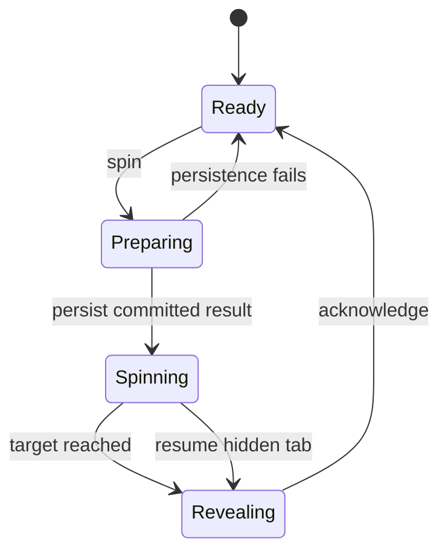

# 🎲 Selection and game semantics

## Equal and weighted selection

Production entropy comes from crypto.getRandomValues(). No Math.random() fallback for selection; unsupported entropy disables selection with a translated explanation. Inject deterministic bytes only through a test-only adapter excluded from production bundles.

For uniform n, take unsigned 32-bit x and accept only x < floor(2^32/n)*n; return x mod n. This avoids modulo bias. Integer ranges use the same sampler over max−min+1. Weight values are positive integers and sum ≤1,000,000 under the selected bounds; sample uniformly within total weight then locate the cumulative interval. Sector sizes match displayed weights. Duplicate labels remain separate entries; never merge without an explicit user action.

Random team assignment: Fisher–Yates shuffle with unbiased indices, then partition into team sizes differing by at most one. Include every active participant once. Reject more teams than active members. Excluded members do not participate; historical records remain intact.

Repeated outcomes are normal in independent mode. Do not silently favor underselected entries. Separate modes: independent, remove-winner-until-reset, and shuffled-cycle (each eligible entry exactly once per cycle). Show mode beside spin controls and in the report. Weighted selection is incompatible with shuffled-cycle in this baseline; reject that combination rather than silently ignoring weights. Numbers, yes/no and teams use independent mode only. Yes/no has exactly two active equal-weight options. Number generation and team allocation are not remove-winner wheel sessions. Reject tool-specific fields on unrelated tools.

## State machine

Controls lock before selection. Persist a spinId, result and input snapshot in one IndexedDB transaction BEFORE animating. Storage failure offers explicit ephemeral mode with a persistent warning; no false saved-history claim. Multiple taps cannot produce parallel spins. Cross-tab wheel editing uses a lease; read-only fallback when another tab owns the active session. See [sessions](05-SESSIONS-REPORTS.md).

## Games

Bottle: 2–20 explicitly placed seats, each linked to a participant. Changes require confirmation and a new round. A geometric angle determines the illustrated selected seat; no camera, microphone or inferred seating. Non-repeating turn mode is optional and visible.

Game engine state: setup, ready, selecting-player, revealing-card, awaiting-complete-or-skip, paused, exhausted, ended. Persist participant selection and card ID together. Skipped cards remain used. Completed and skipped are separate outcomes; neither implies an obligation or penalizes refusal. Pack exhaustion offers restart/new pack/end, never silently repeats. Pausing or switching language preserves selected card and used-card IDs. Localized replacements retain card IDs.

Use fixed published pack versions for an active session; content updates do not rewrite historical text. Restored sessions recover the last unresolved card. Ready-made dares exclude explicit sexual content, intoxication pressure, dangerous stunts, humiliation and coercion. User text is rendered as text, never HTML. Content suitability and culture reviews are release evidence, not an automatic classifier guarantee.

## Verification

Exhaustively test rejection boundaries with deterministic vectors, integer endpoints, cumulative weight edges, zero/one active entries, max limits, removed winners and shuffled-cycle uniqueness. Statistical simulations supplement these proofs/tests and are not a guarantee of fairness. The browser is user-controlled: Lavbe is not a tamper-proof certified prize drawing service.
